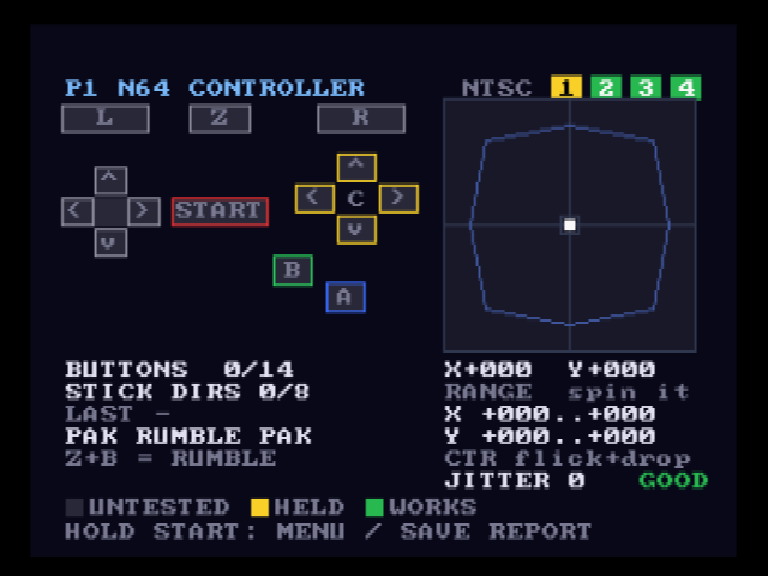
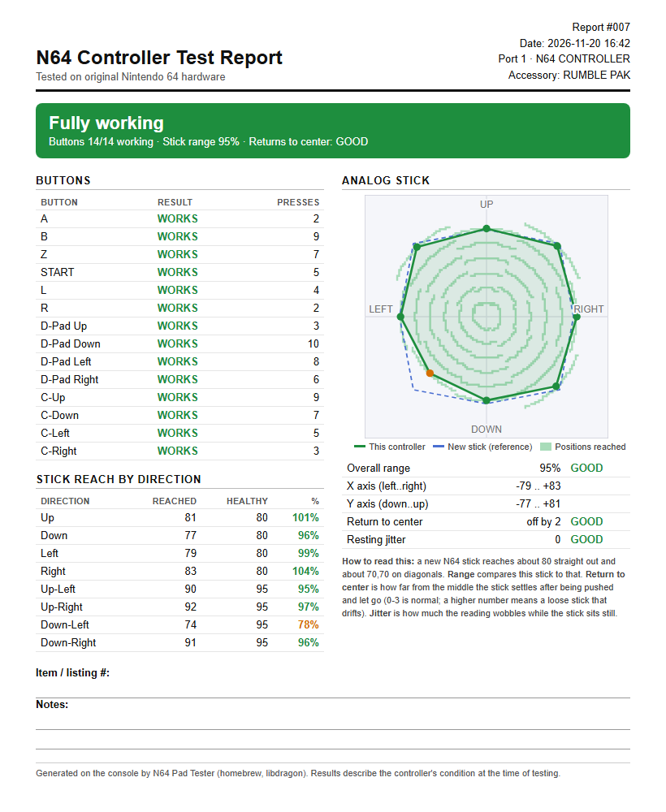

# N64 Pad Tester

A Nintendo 64 controller tester that runs on real hardware from a flashcart.
Check every button, measure how worn the analog stick is, and save a
printable one-page report to the SD card — handy for repairs and for
listing controllers for sale.



## Features

- **Every button, three states:** grey = not tested yet, yellow = held right
  now, green = works (has been pressed at least once).
- **Analog stick health:**
  - live position and a trail of everywhere the stick has been
  - how far it reaches in each of the 8 directions, compared with a new stick
  - min/max on each axis
  - **return to center** — flick the stick and let go; a loose, worn stick
    doesn't snap back to zero (the classic N64 "drift")
  - **jitter** — how much the reading wobbles while the stick is untouched
- **All 4 ports**, plug and unplug any time. Press a button on another
  controller to switch to it.
- **Accessory detection** (Rumble Pak, Controller Pak, Transfer Pak) and a
  rumble test (Z + B).
- **Printable report** saved to the SD card as a web page — open it on any
  computer and print it or save it as a PDF.
- **Adjustable picture size** (100% to 80%) so nothing is cut off on CRT TVs.
  The setting is remembered on the SD card.

## Sample report



*(made-up results, shown to preview the layout)*

The report gives a plain-English verdict (*Fully working*, *Working – analog
stick shows wear*, *Buttons work – analog stick needs repair*, or *Test
incomplete*), every button's result, a chart of the stick's reach, the
measurements with a short explanation, and blank lines for an item/listing
number and notes.

## How to use

1. Download `n64-pad-tester.z64` from the
   [Releases](../../releases) page.
2. Copy it to your flashcart's SD card and start it from the menu.
3. Test the controller:
   - press every button
   - spin the stick all the way around a few times
   - flick the stick in a few directions and let it snap back
   - leave the stick alone for a second to measure jitter
4. **Hold START** to open the menu:

   | Menu item | What it does |
   |---|---|
   | SAVE REPORT TO SD | writes `n64padtester/report_001.html` (the number goes up each time) |
   | VIEW REPORT | shows the verdict on the TV — good for photos |
   | SCREEN SIZE | left/right on the D-pad to shrink the picture for CRTs |
   | RESET THIS PORT | clears the results to test the next controller |

5. Put the SD card in a computer, open the report in a web browser, and print
   it (Ctrl+P) or save it as a PDF.

Other controls: **L + R + START** is the controller's own built-in stick
re-center.

The report date comes from the flashcart's real-time clock. If the clock
isn't set, the report prints a blank date line to fill in by hand.

## Compatibility

| Flashcart | Runs | Saves reports |
|---|---|---|
| SummerCart64 | ✅ tested | ✅ |
| EverDrive 64 (X7 / V3) | should work, untested | should work, untested |
| 64drive | should work, untested | should work, untested |
| Emulators (ares) | ✅ | ❌ no SD card |

Tried it on another flashcart? Please open an issue and say how it went.

**SummerCart64 users:** N64FlashcartMenu 0.3.4 leaves the video chip in a
state that hangs most libdragon programs (black screen). This tester works
around it, but updating the menu to 0.3.5 or newer is a good idea anyway.

## Building from source

The tester is written in C with [libdragon](https://github.com/DragonMinded/libdragon).

You need the libdragon toolchain and a recent libdragon (`trunk` branch,
commit `e356bf3` or newer) installed, with `N64_INST` set. On Windows, use WSL.

```sh
make            # n64-pad-tester.z64
make DEBUG=1    # n64-pad-tester-debug.z64: on-screen boot steps + frame counter
```

`build.sh` is a small wrapper that sets `N64_INST` to `~/n64dev/tc/opt/libdragon`
if it isn't set already.

To preview the printed report layout on a PC (just needs `gcc`):

```sh
make sample-report.html
```

Releases are built automatically by GitHub Actions
(`.github/workflows/build.yml`) when a version tag such as `v1.0.0` is pushed.

## License

[MIT](LICENSE)
